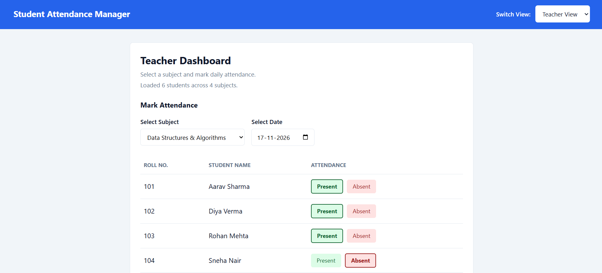
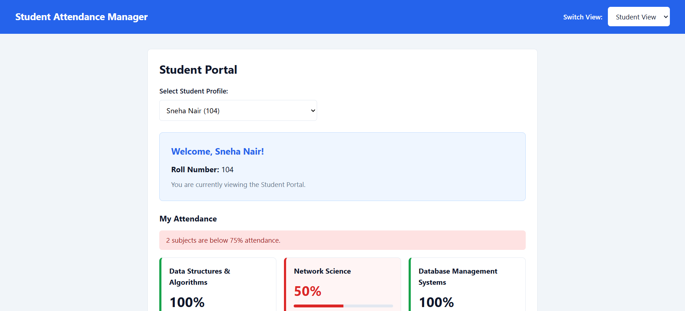

# 🎓 Student Attendance Manager

A lightweight, browser-based web app for recording and tracking student attendance across subjects. Teachers mark daily attendance, manage the class roster and approve or reject leave requests. Students view their attendance percentage per subject and apply for leave. All data lives in the browser's `localStorage`, so no backend or database is needed.

> **Repository:** [MalayaGupta/student-attendance-manager](https://github.com/MalayaGupta/student-attendance-manager)
> **Status:** all 6 planned features are implemented and merged into `main` through pull requests #1–#6.

---

## 📌 Objectives

- Replace paper attendance registers with a simple digital tool.
- Let teachers **mark attendance** per subject and per date.
- Let teachers **add and remove students** from the roster.
- Give students a clear view of their **attendance percentage**, flagging any subject **below 75%**.
- Provide a **leave application and approval** workflow, where approved leaves are **excluded from the total class count**.
- Practise a real-world **Git/GitHub team workflow**: feature branches, pull requests, code reviews and merge-conflict resolution.

---

## 👥 Team Members and Contributions

| Member | GitHub | Features (branch) |
|--------|--------|-------------------|
| **Malaya Gupta** (Roll No. 36, repo owner) | [@MalayaGupta](https://github.com/MalayaGupta) | Manage Students (`feature-malaya/manage-students`), Student Percentage View (`feature-malaya/student-percentage-view`), Leave Application (`feature-malaya/leave-application`) |
| **Ansh Chaturvedi** (Roll No. 12) | [@anshchaturvedi0210](https://github.com/anshchaturvedi0210) | Mark Attendance (`feature-anshchaturvedi/mark-attendance`), Role Switcher (`feature-anshchaturvedi/role-switcher`), Leave Approval (`feature-anshchaturvedi/leave-approval`) |

See [CONTRIBUTING.md](CONTRIBUTING.md) for the full workflow, per-feature file breakdown and the merge-conflict example.

---

## ✨ Features

| # | Feature | Owner | Pull Request | What it does |
|---|---------|-------|:------------:|--------------|
| 1 | **Manage Students** | Malaya | #1 | Add a student (Roll No + Name) with validation and duplicate checks, or remove one. Removing also deletes that student's attendance records and leave requests |
| 2 | **Mark Attendance** | Ansh | #2 | Subject and date selectors, a student table with Present/Absent buttons, and a Save button that writes to the store |
| 3 | **Role Switcher** | Ansh | #3 | Top-bar dropdown to switch between Teacher View and Student View, plus a student-profile selector in the portal |
| 4 | **Student Percentage View** | Malaya | #4 | One card per subject with percentage, progress bar and "x of y classes attended". Subjects **below 75%** are highlighted with a warning |
| 5 | **Leave Application** | Malaya | #5 | Student form (subject, date, reason) with validation, plus a "My Leave Requests" table with status badges |
| 6 | **Leave Approval** | Ansh | #6 | Teacher sees pending requests with **Approve / Reject** buttons. Approved leave is recorded as `"Leave"` and excluded from the student's total class count |

### Business rules worth knowing

- **Attendance %** = `Present ÷ (Present + Absent) × 100`, rounded to one decimal place. Days marked `Leave` are **not counted** in the total.
- A subject with no recorded classes shows "—" instead of 0%.
- Leave cannot be requested for a **past date**, an invalid date, or a duplicate subject and date (a rejected request may be re-submitted). Reasons are limited to 200 characters.
- Roll numbers may contain only letters, digits and hyphens, and are unique (case-insensitive).

---

## 🛠️ Technologies

| Area | Technology |
|------|------------|
| Structure | HTML5 |
| Styling | CSS3 (custom properties, flexbox/grid) |
| Logic | Vanilla JavaScript (ES6), no frameworks or build step |
| Persistence | Browser `localStorage` (key `sam_data_v1`) |
| Testing | Plain Node.js scripts using the built-in `assert` module |
| Collaboration | Git and GitHub (feature branches, pull requests, code review) |

---

## 📁 Project Structure

```text
student-attendance-manager/
├── index.html            # Page shell: navbar, Teacher and Student sections
├── style.css             # All styles (cards, tables, forms, badges)
├── .gitignore
├── README.md             # Project documentation
├── CONTRIBUTING.md       # Team workflow and contributions
├── js/
│   ├── store.js          # Data layer: localStorage + all business logic
│   ├── teacher.js        # Teacher Dashboard: attendance, leave approvals, roster
│   ├── student.js        # Student Portal: percentage cards, leave form
│   └── app.js            # Entry point and Teacher/Student view switching
└── tests/
    ├── store.test.js     # Add/remove student logic
    ├── summary.test.js   # Attendance percentage calculation
    └── leave.test.js     # Leave application rules
```

### Data model (`js/store.js`)

```js
{
  subjects: [{ id, name }],
  students: [{ roll, name }],
  // records[subjectId][date][roll] = "Present" | "Absent" | "Leave"
  records:  { },
  leaves:   [{ id, roll, subjectId, date, reason, status: "Pending" | "Approved" | "Rejected" }]
}
```

Default data: 4 subjects (DSA, NS, DBMS, OOP) and 5 students (roll numbers 101–105).

### Main `Store` methods

| Method | Purpose |
|--------|---------|
| `addStudent(roll, name)` / `removeStudent(roll)` | Manage the roster |
| `getAttendanceSummary(roll)` | Per-subject present, total and percent for one student |
| `applyLeave(roll, subjectId, date, reason)` | Validate and create a Pending leave request |
| `getLeavesForStudent(roll)` | A student's requests, newest first |
| `getPendingLeaves()` | All requests awaiting a decision |
| `updateLeaveStatus(id, status)` | Approve or reject; approval marks the date as `Leave` |

---

## ⚙️ Installation and Execution

No dependencies or build step are required.

1. **Clone the repository**

   ```bash
   git clone https://github.com/MalayaGupta/student-attendance-manager.git
   cd student-attendance-manager
   ```

2. **Run the app**: open `index.html` directly in a browser, or serve it locally:

   ```bash
   # Option 1: Python 3
   python -m http.server 8000

   # Option 2: Node.js
   npx serve .
   ```

3. **Open** <http://localhost:8000> in your browser.

4. **Try it out**
   1. In **Teacher View**, pick a subject and date, mark every student Present or Absent, and click **Save Attendance**.
   2. Switch to **Student View**, choose a profile and check the percentage cards.
   3. Submit a leave request, switch back to **Teacher View** and **Approve** it.

> 💡 **Reset all data:** open the browser DevTools console, run `localStorage.removeItem("sam_data_v1")` and refresh the page.

### Running the tests

Requires [Node.js](https://nodejs.org/). Run from the project root:

```bash
node tests/store.test.js
node tests/summary.test.js
node tests/leave.test.js
```

Each script prints a "passed" message on success and throws an assertion error on failure.

---

## 🖼️ Screenshots / Sample Output

Save screenshots in a `screenshots/` folder with the file names below, then commit them.

| Teacher Dashboard | Student Portal |
|:-----------------:|:--------------:|
| (screenshots/teacher_dashboard_2.png) | (screenshots/student_portal_2.png) |

**Sample student attendance cards:**

| Subject | Classes attended | Percentage | Status |
|---------|:----------------:|-----------:|--------|
| Data Structures & Algorithms | 9 of 10 | 90% | ✅ Good |
| Network Science | 6 of 10 | 60% | ⚠️ **Below 75% – attendance shortage** |
| Object-Oriented Programming | no classes yet | — | No data |

**Sample banner:** `1 subject is below 75% attendance.`

**Sample test output:**

```text
$ node tests/leave.test.js
All leave tests passed.
```

---

## 🌿 Git Workflow Summary

- `main` holds the stable, merged code. Every feature reached it through a **pull request**.
- Each feature was built on its own branch (`feature-<name>/<feature>`).
- One real **merge conflict** (in `js/student.js` and `style.css`) was resolved in commit [`268026b`](https://github.com/MalayaGupta/student-attendance-manager/commit/268026b) before PR #4 was merged.

Full details are in [CONTRIBUTING.md](CONTRIBUTING.md).

---

## 📄 License

Built for academic purposes as a demonstration of Git and GitHub collaboration.
